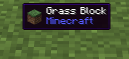
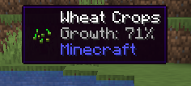
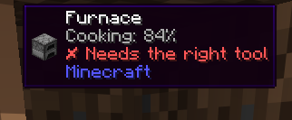

# Jade for Horizon

[English](README.md)

Portage non officiel de [Jade](https://www.curseforge.com/minecraft/mc-mods/jade) (Snownee) pour [Horizon](https://playhorizon.dev) (jeu 26.3, API de mod 0.2). Le Jade d'origine est un mod Java NeoForge, qui ne peut pas tourner dans Horizon : ce mod réécrit ses fonctions principales en Rust (WebAssembly), avec le SDK officiel.

## Captures d'écran

| Bloc | Croissance d'une culture | Four |
| --- | --- | --- |
|  |  |  |

## Ce qu'il affiche

En haut de l'écran, une infobulle sur ce que vise le réticule :

- **Bloc** : icône, nom (dans la langue du jeu), mod d'origine, et selon le bloc :
  - croissance des cultures (blé, carottes, pommes de terre, betteraves, tiges de melon et de citrouille, cacao, verrues du Nether, baies sucrées, torchflower, pitcher ; et toute culture moddée qui a une propriété `age`) : « Croissance : 57 % » ou « Mûr » ;
  - miel et nombre d'abeilles d'une ruche, niveau d'un composteur, charges d'une ancre de réapparition, humidité d'une terre labourée, éclosion des œufs de tortue et de renifleur, parts restantes d'un gâteau ;
  - redstone : puissance (fil, capteur de lumière, cible, capteurs sculk, plaques de pression pondérées), délai d'un répéteur, mode d'un comparateur, état d'un levier ;
  - note et instrument d'un bloc musical, disque d'un jukebox, créature d'un spawner ;
  - contenu d'un conteneur (coffre, tonneau, entonnoir, four, feu de camp…), regroupé par objet, jusqu'à 18 icônes avec leur nombre ; « Butin pas encore ouvert » pour un coffre de structure jamais ouvert ; rien pour un conteneur verrouillé (`lock` vanilla), même pour qui a la clé ;
  - cuisson d'un four, fumoir ou haut fourneau, infusion d'un alambic ;
  - si l'objet en main permet de récolter le bloc (pour les blocs qui ne lâchent rien sans le bon outil) ;
  - une barre de progression pendant le minage.
- **Entité** : nom, points de vie (❤ 18 / 20), mod d'origine, et selon l'entité :
  - animaux : temps avant de devenir adulte, temps avant de pouvoir se reproduire, mode amoureux, temps avant le prochain œuf (poules) ;
  - animaux apprivoisés : propriétaire ;
  - chevaux, ânes, mules, lamas : vitesse (blocs/s), hauteur de saut (blocs), force des lamas ;
  - villageois : métier et niveau ; zombie-villageois en cours de guérison : temps restant ;
  - effets actifs (nom, niveau, durée) ;
  - cadre : l'objet qu'il contient ; TNT allumée : temps avant l'explosion.

La touche **0 du pavé numérique** affiche ou masque l'infobulle (modifiable dans Options > Commandes).

## Réglages

Dans **Options > Mods > Jade for Horizon > Config** :

- **Thème** : Vanilla (infobulle de Minecraft), Sombre, Clair, Waila ;
- **Position** : en haut au centre, à gauche ou à droite ;
- **Taille** : de 0,5 à 2 ;
- une case par type d'information (nom du mod, points de vie, croissance, minage, outil, détails des blocs, cuisson, contenus, reproduction, chevaux, propriétaire, villageois, effets).

Les points de vie, les données des animaux, des villageois et des chevaux, les effets, les contenus et la progression des fours et alambics ne sont connus que du serveur. Le mod les demande quelques fois par seconde, seulement pour une cible à moins de 24 blocs. Sur un serveur sans ce mod, l'infobulle marche quand même, sans ces lignes. Le propriétaire d'un animal s'affiche par son nom s'il est connecté, sinon par son UUID.

Jade compte aussi des centaines d'intégrations avec d'autres mods Java (Create, Mekanism…) : elles n'ont pas d'équivalent dans Horizon.

## Installation

1. Téléchargez `jade_horizon.hmod` depuis la [dernière release](https://github.com/Pierddev/jade-horizon/releases/latest). N'installez que le fichier de cette page.
2. Ouvrez le dossier de données de Horizon : `Win + R`, tapez `%APPDATA%\horizon` puis Entrée.
3. Copiez `jade_horizon.hmod` dans le dossier `horizon-mods` (créez-le s'il n'existe pas).
4. Ouvrez `horizon-mods.txt` dans le même dossier (créez-le si besoin) et ajoutez cette ligne :

   ```
   mod.jade_horizon:true
   ```

   Avec `false`, le mod est désactivé sans être supprimé.
5. Relancez Horizon.

Pour mettre à jour, remplacez le fichier `.hmod` par le nouveau et relancez. Pour désinstaller, supprimez le fichier et sa ligne dans `horizon-mods.txt`.

Le mod est compilé pour une version précise de Horizon (Nightly `0a875da`, API de mod 0.2). Sur une autre version, il peut être refusé au chargement : voyez les notes de la release.

**Sécurité :** un `.hmod` a les mêmes accès à votre ordinateur que le jeu. N'installez que des mods dont vous faites confiance aux auteurs.

En multijoueur, installez-le côté client pour l'infobulle. Le mettre aussi sur le serveur ajoute les données de santé, d'animaux, de villageois, de chevaux et de contenu (voir plus haut).

## Compiler depuis les sources

```powershell
.\build.ps1
```

Compilation dans WSL (Ubuntu), copie dans `%APPDATA%\horizon\horizon-mods\`, activation dans `horizon-mods.txt`. Relancer Horizon ensuite.

## Licence et crédits

CC-BY-NC-SA-4.0 (voir [LICENSE](LICENSE) et [NOTICE](NOTICE)), comme Jade. Usage non commercial uniquement.

Jade est l'œuvre de [Snownee et ses contributeurs](https://github.com/Snownee/Jade), sous licence CC BY-NC-SA 4.0. Ce portage non officiel est une adaptation (réécriture en Rust pour Horizon, avec seulement une partie des fonctions de Jade). Il ne contient aucun asset ni donnée de Minecraft : les icônes et les noms sont lus dans le jeu du joueur. Il n'est pas affilié à Snownee ni au projet Horizon.
