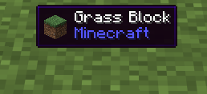
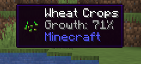
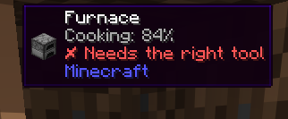

# Jade for Horizon

[Français](README.fr.md)

Unofficial port of [Jade](https://www.curseforge.com/minecraft/mc-mods/jade) (by Snownee) to [Horizon](https://playhorizon.dev) (game 26.3, mod API 0.2). The original Jade is a Java NeoForge mod and cannot run in Horizon: this mod rewrites its main features in Rust (WebAssembly), using the official SDK.

## Screenshots

| Block | Crop growth | Furnace |
| --- | --- | --- |
|  |  |  |

## What it shows

A tooltip at the top of the screen for whatever the crosshair is on:

- **Block**: icon, name (in the game's language), originating mod, and depending on the block:
  - crop growth (wheat, carrots, potatoes, beetroots, melon and pumpkin stems, cocoa, nether wart, sweet berries, torchflower, pitcher plant, and any modded crop with an `age` property): "Growth: 57%" or "Mature";
  - honey level and bee count of a hive, compost level, respawn anchor charges, farmland moisture, turtle and sniffer egg hatching, cake slices left;
  - redstone: power (wire, daylight detector, target, sculk sensors, weighted pressure plates), repeater delay, comparator mode, lever state;
  - a note block's note and instrument, a jukebox's disc, a spawner's mob;
  - a container's contents (chest, barrel, hopper, furnace, campfire…), merged by item, up to 18 icons with counts; "Unopened loot" for a structure chest never opened;
  - cooking progress of a furnace, smoker or blast furnace, brewing progress of a brewing stand;
  - whether the item in your hand can harvest the block (for blocks that drop nothing without the right tool);
  - a progress bar while mining.
- **Entity**: name, health (❤ 18 / 20), originating mod, and depending on the entity:
  - animals: time until adulthood, time until they can breed again, love mode, time until the next egg (chickens);
  - tamed animals: owner;
  - horses, donkeys, mules, llamas: speed (blocks/s), jump height (blocks), llama strength;
  - villagers: profession and level; a zombie villager being cured: time left;
  - active effects (name, level, duration);
  - item frame: the item it holds; primed TNT: time until it explodes.

The **numpad 0** key shows or hides the tooltip (rebindable in Options > Controls).

## Settings

In **Options > Mods > Jade for Horizon > Config**:

- **Theme**: Vanilla (Minecraft's tooltip), Dark, Light, Waila;
- **Position**: top centre, left or right;
- **Size**: 0.5 to 2;
- one toggle per kind of information (mod name, health, growth, mining, harvest tool, block details, cooking, contents, breeding, horse stats, owner, villagers, effects).

Health, animal, villager and horse data, effects, contents and furnace/brewing progress are only known to the server. The mod requests them a few times per second, only for a target within 24 blocks. On a server without this mod, the tooltip still works, just without those lines. An animal's owner shows by name when online, else by UUID.

Jade also has hundreds of integrations with other Java mods (Create, Mekanism…): they have no Horizon counterpart.

## Installation

1. Download `jade_horizon.hmod` from the [latest release](https://github.com/Pierddev/jade-horizon/releases/latest). Only install the file from this release page.
2. Open Horizon's data folder: press `Win + R`, type `%APPDATA%\horizon` and press Enter.
3. Copy `jade_horizon.hmod` into the `horizon-mods` folder (create it if it does not exist).
4. Open `horizon-mods.txt` in the same data folder (create it if needed) and add this line:

   ```
   mod.jade_horizon:true
   ```

   Setting it to `false` disables the mod without deleting it.
5. Restart Horizon.

To update, replace the `.hmod` file with the new one and restart. To uninstall, delete the file and its line in `horizon-mods.txt`.

The mod is built for a specific Horizon build (Nightly `0a875da`, mod API 0.2). On another build it may be refused at load time: check the release notes for the supported version.

**Security:** a `.hmod` runs with the same access to your computer as the game. Only install mods from authors you trust.

For multiplayer, install it on the client for the tooltip. Installing it on the server too adds health, animal, villager, horse and container data (see above).

## Build from source

```powershell
.\build.ps1
```

Builds in WSL (Ubuntu), copies the result into `%APPDATA%\horizon\horizon-mods\` and enables it in `horizon-mods.txt`. Restart Horizon afterwards. Use `.\build.ps1 -NoInstall` to build only.

## Licence and credits

CC-BY-NC-SA-4.0 (see [LICENSE](LICENSE) and [NOTICE](NOTICE)), like Jade. Non-commercial use only.

Jade is the work of [Snownee and contributors](https://github.com/Snownee/Jade), licensed under CC BY-NC-SA 4.0. This unofficial port is an adaptation (a rewrite in Rust for Horizon, covering only part of Jade's features). It contains no Minecraft assets or data: icons and names are read from the player's own game. It is not affiliated with Snownee or the Horizon project.
